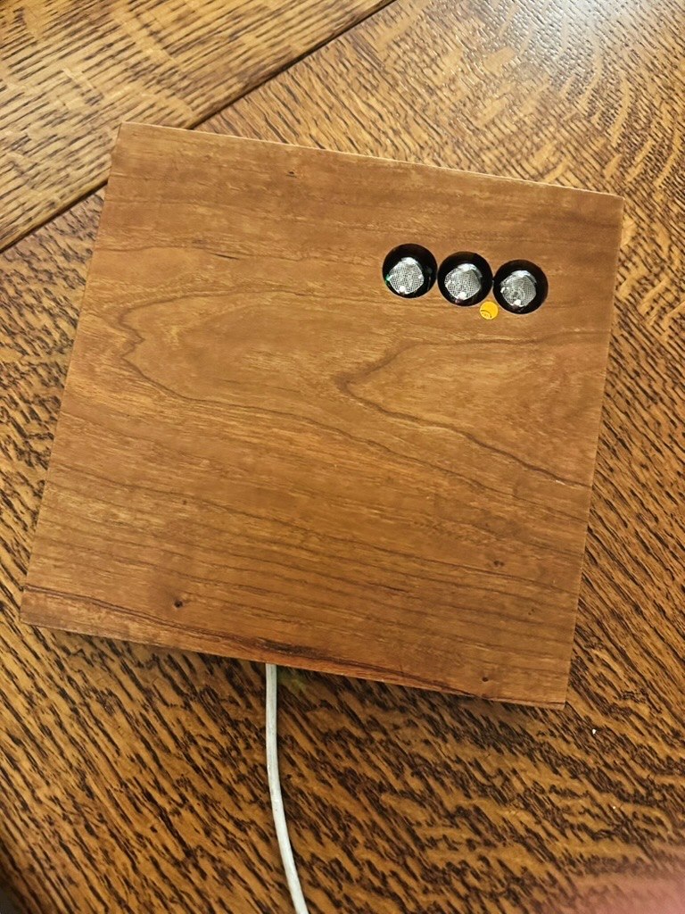
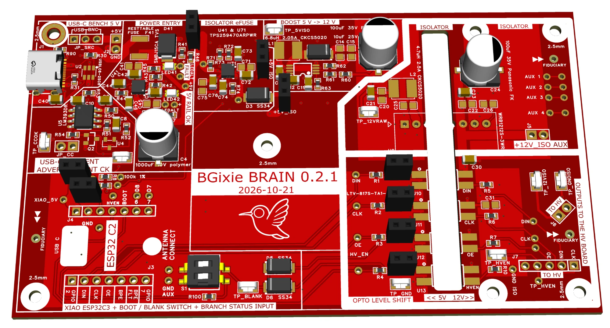
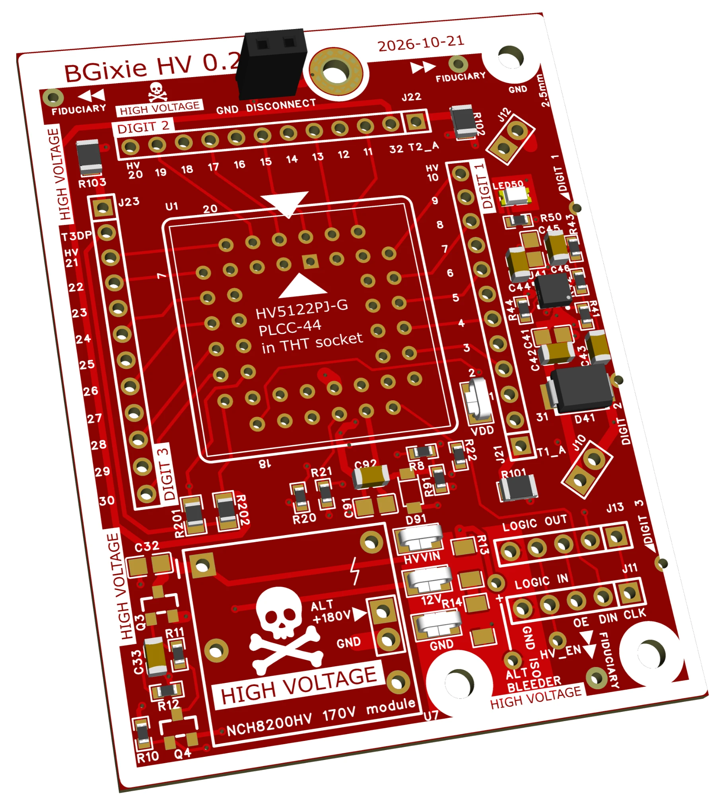

# BGixie hardware

Hardware design files for BGixie, a display that shows a live blood glucose value on Nixie tubes.

*A BGixie prototype in a wooden case.*

The design has two boards:

- **Brain**: 5 V power input with protection, a Seeed XIAO ESP32-C3, and an isolated 12 V supply.
- **HV board**: a 170 V supply and an HV5122 driver for three tubes. Boards can be cascaded.

The EasyEDA project for both boards is in this repository: `BGixie-Modular-A3 (brain + HV PCBs)_2026-11-09_0.2.1.epro2` (version 0.2.1). Read [RELEASE-NOTES.md](RELEASE-NOTES.md) before building: it contains a required change to the HV board bleeder. `Nixie 7.1_2026-11-09.epro2` holds the Nixie 7.1 PCB for IN-2 tubes; the release notes explain how 0.2.1 uses it. The BGixie software is not part of this repository.

**Warning:** the design contains a 170 V supply. Treat it as hazardous.

## PCBs

3D renders of the two boards. Not every part appears in them.

### Brain PCB

### HV PCB

## Schematics

PDF schematics of the brain and the HV board, rev A3, dated 2026-10-17:

- [Brain schematic](BGixie%20brain,%20rev%20A3%20%282026-10-17%29.pdf)
- [HV board schematic](BGixie%20HV%20board,%20rev%20A3%20%282026-10-17%29.pdf)

They show the HV board bleeder as R13 and R14, two 220 kΩ resistors; [RELEASE-NOTES.md](RELEASE-NOTES.md) describes the required change to 1 MΩ. The EasyEDA project (0.2.1, 2026-11-09) is the reference design. Each PDF carries the CERN-OHL-P-2.0 notice and has the full licence text attached.

## Nixie 7.1 PCB drawings

Drawings of the Nixie 7.1 PCB, exported 2026-11-23:

- [Top assembly drawing](Nixie%207.1,%20top%20assembly%20drawing%20%282026-11-23%29.pdf)
- [Bottom assembly drawing](Nixie%207.1,%20bottom%20assembly%20drawing%20%282026-11-23%29.pdf)
- [Drill drawing](Nixie%207.1,%20drill%20drawing%20%282026-11-23%29.pdf)

The pages are small, so zoom in to read them. The PCB file is `Nixie 7.1_2026-11-09.epro2`. Each PDF carries the CERN-OHL-P-2.0 notice and has the full licence text attached.

## Licence

SPDX-License-Identifier: CERN-OHL-P-2.0

Copyright 2026 peculiarimages. This source describes Open Hardware and is licensed under the CERN-OHL-P v2.

You may redistribute and modify this source and make products using it under the terms of the CERN-OHL-P v2 (https://ohwr.org/cern_ohl_p_v2.txt).

This source is distributed WITHOUT ANY EXPRESS OR IMPLIED WARRANTY, INCLUDING OF MERCHANTABILITY, SATISFACTORY QUALITY AND FITNESS FOR A PARTICULAR PURPOSE. Please see the CERN-OHL-P v2 for applicable conditions.

Source location: https://github.com/peculiarimages/BGixie-hardware
